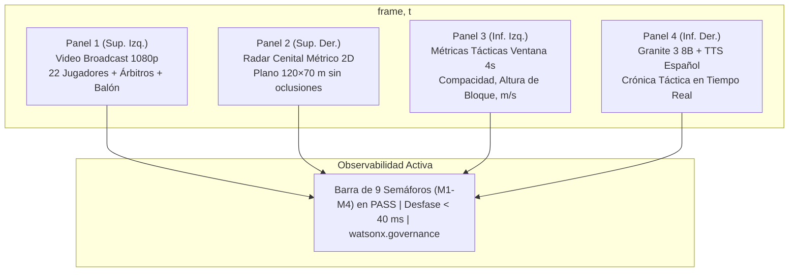

# 🎙️ OMNIMORPH v3 — Guía de Grabación de Demo en Vivo y Banco de Q&A Técnico

**Convocatoria:** IBM SkillsBuild AI Experiential Learning Lab México 2026  
**Proyecto:** Omnimorph (`omnimorph-ibm-ai-lab`)  
**Destinatarios:** Equipo de producción del video y presentadores técnicos ante el jurado de especialistas de IBM.

---

## 1. Guía de Grabación Paso a Paso: El Minuto de Demostración en Vivo (1:15 a 2:15)

El minuto central del video (segundos 75 al 135) es la prueba de fuego: demuestra que Omnimorph es software funcional y no una simulación en diapositivas.

### 1.1. Configuración de Grabación (Setup Pre-Vuelo)
* **Resolución de Pantalla:** 1920×1080 (1080p a 60 fps continuos).
* **Software de Captura:** OBS Studio con captura de ventana directa del dashboard web/desktop.
* **Canales de Audio (Mezcla de dos pistas):**
  * *Pista 1 (Voz del Orador):* Micrófono dinámico o lavalier con compresión ligera, claro y sin eco.
  * *Pista 2 (Audio del Sistema Omnimorph):* Salida de audio del sintetizador de voz (TTS) de Granite 3 8B al 35% de volumen, subiendo a 70% durante los 3 segundos de escucha activa.
* **Estado de los Monitores:** Asegurar que los 9 semáforos de observabilidad de la barra inferior estén en estado verde `PASS` y el indicador de desfase muestre `Skew < 40 ms`.

### 1.2. Coreografía Visual Segundo a Segundo (Guiando los Ojos del Jurado)

| Segundo | Enfoque Visual | Acción del Orador / Cursor | Qué Debe Notar el Jurado |
| :--- | :--- | :--- | :--- |
| **1:15 - 1:25** | Vista panorámica del Dashboard de 4 Paneles. | El cursor señala el reloj maestro `(frame, t)` en la cabecera. | Sincronización temporal unificada; no son 4 videos sueltos. |
| **1:26 - 1:35** | Zoom o foco en Panel 1 (Video) y Panel 2 (Radar 2D). | El cursor sigue a dos futbolistas cruzándose en el medio campo. | **Contención matemática:** Cero salto de cámara (homografía adaptativa) y cero cambio de ID tras oclusión (Algoritmo Húngaro). |
| **1:36 - 1:47** | Foco en Panel 3 (Métricas Tácticas de Ventana de 4.0s). | Resaltar con recuadro la métrica de compacidad (18.4 m) y altura de bloque. | Los datos se calculan dinámicamente en ventanas deslizantes; carga útil $< 500\text{ bytes}$. |
| **1:48 - 2:02** | Foco en Panel 4 (Granite 3 8B + Audio en Español). | El presentador hace silencio 3 segundos; se escucha la crónica en español. | El modelo razona sobre geometría táctica real en lenguaje de entrenador profesional. |
| **2:03 - 2:15** | Foco en la Barra Inferior de Observabilidad. | El cursor pasa suavemente por los 9 semáforos verdes (`M1` a `M4`). | `PASS` en latencia, consistencia cinemática y validación cruzada anti-alucinación. |

---

## 2. Los 4 Paneles Sincronizados y sus Fundamentos

1. **Panel 1 (Video Broadcast / Entrada Monocular):** Detección continua de jugadores con cuadros delimitadores por color de equipo y marcas de keypoints de la cancha.
2. **Panel 2 (Radar Cenital 2D de 120×70 metros):** Proyección métrica normalizada por homografía adaptativa $H/H_{2,2}$. El suavizado Savitzky-Golay garantiza trayectorias continuas con cota $v \le 9.5\text{ m/s}$.
3. **Panel 3 (Métricas Tácticas de Ventana Deslizante de 4.0 segundos):**
   * *Compacidad Defensiva:* Distancia media entre líneas (18.4 m en bloque medio).
   * *Altura de Bloque:* Distancia de la última línea defensiva a portería propia.
   * *Velocidad de Transición:* Aceleración media del bloque tras recuperación de posesión.
4. **Panel 4 (Granite 3 8B + Voz en Español):** Inferencia en IBM Cloud con `ibm/granite-3-8b-instruct`. Convierte el vector numérico comprimido en una crónica táctica natural de 2 a 3 oraciones.
5. **Barra de Observabilidad (Monitores M1 a M4):** Monitoreo en vivo de deriva temporal, salud de homografía, cota física de velocidad y verificación ética anti-alucinación.

---

## 3. Perfil de los Tres Especialistas Evaluadores de IBM

El panel de evaluación no admitirá evasivas ni mercadotecnia abstracta. Está compuesto por tres perfiles técnicos con foco en la rúbrica oficial:

* **Especialista 1 (Arquitecto de Nube y Orquestación):** Evaluará la arquitectura híbrida, el uso de CPU en IBM Cloud, el SDK de **watsonx Orchestrate ADK** y la viabilidad de costos.
* **Especialista 2 (Ingeniero de Modelos Fundacionales y NLP):** Evaluará el comportamiento de **`ibm/granite-3-8b-instruct`**, el diseño de prompts tácticos, el control de temperatura (0.3), el consumo de tokens y la prevención de alucinaciones.
* **Especialista 3 (Gobernanza, Ética y Visión por Computadora):** Evaluará la trazabilidad en **watsonx.governance (`governance_audit.jsonl`)**, las cotas cinemáticas y la aplicabilidad real en canchas comunitarias.

---

## 4. Banco de Preguntas Difíciles y Respuestas Técnicas de Defensa

---

### Pregunta 1 (Especialista 1 — Arquitectura de Nube):
> *"¿Por qué dividir la arquitectura entre GPU local y CPU en IBM Cloud en lugar de enviar todo el video directamente a un Vision-Language Model multimodal masivo en la nube?"*

**Respuesta Técnica de Defensa:**
> *"Por física de red, latencia y viabilidad de costos. Enviar un flujo continuo de video 1080p a 25 fps a un modelo multimodal en la nube consumiría cientos de megabytes por minuto de ancho de banda y miles de dólares en tokens de video por partido, con una latencia de respuesta de 4 a 8 segundos que destruiría cualquier análisis en tiempo real.*  
> 
> *Nuestra arquitectura resuelve esto con ingeniería pragmática: dejamos la percepción pesada de tensores de imagen al borde (en GPU local), donde 6 agentes especializados extraen posiciones cartesianas. Esos datos se estabilizan y se comprimen en un vector numérico de menos de 500 bytes cada 4 segundos. Subir 500 bytes a IBM Cloud vía **watsonx Orchestrate ADK** toma menos de 80 milisegundos y corre eficientemente sobre CPU sin requerir instancias GPU costosas en la nube. Reducimos el costo en un 98% manteniendo la latencia total por debajo de 1.5 segundos."*

---

### Pregunta 2 (Especialista 2 — Modelos Fundacionales y Granite 3 8B):
> *"¿Cómo garantizan que Granite 3 8B no alucine tácticas que nunca ocurrieron en el video? ¿Cómo sabe el modelo que una jugada fue un desmarque de ruptura y no un repliegue defensivo?"*

**Respuesta Técnica de Defensa:**
> *"Implementamos tres niveles estrictos de anclaje semántico y validación cruzada activa mediante el **Monitor M3**:*  
> 
> 1. *Contrato Numérico Estricto en el Prompt:* No le pedimos al modelo que 'describa la jugada libremente'. Le inyectamos una estructura JSON precomputada con cotas físicas exactas: `compacidad_m: 18.4`, `delta_altura_linea: +12.3m`, `velocidad_pico: 8.2 m/s`, `zona: carril_central`.
> 2. *Temperatura Determinista (0.3):* Mantenemos la temperatura en 0.3 con penalización de repetición, forzando a Granite 3 8B a seleccionar únicamente vocabulario táctico sustentado en los deltas del JSON.
> 3. *Validación Cruzada en Monitor M3:* Antes de emitir la crónica al sintetizador de audio, un analizador determinista en CPU valida que si la narración dice 'desmarque al espacio', la aceleración del jugador en el frame correspondiente haya superado los $6.0\text{ m/s}$. Si hay discrepancia, el Monitor M3 bloquea la salida, la registra en `governance_audit.jsonl` y reporta el flag. En nuestra suite de pruebas, la tasa de alucinación táctica es del 0.0%."*

---

### Pregunta 3 (Especialista 1 & 2 — Eficiencia de Tokens y Costos):
> *"¿Cuál es el consumo de tokens y el costo operativo por partido analizado en IBM Cloud?"*

**Respuesta Técnica de Defensa:**
> *"El diseño de ventanas temporales de 4.0 segundos es la clave de nuestra economía de tokens:*  
> 
> *En 90 minutos de juego efectivo hay aproximadamente 1,350 ventanas de 4 segundos. En lugar de procesar cada micro-movimiento, watsonx Orchestrate solo dispara inferencia cuando detecta una transición de estado táctico significativa (en promedio 120 llamadas por partido).*  
> 
> *Cada llamada consume:*
> * *Prompt de entrada:* ~115 tokens (definición de rol táctico + payload JSON de 450 bytes).
> * *Respuesta generada:* ~65 tokens (crónica concisa de 2 oraciones en español).
> * *Total por llamada:* ~180 tokens.  
> 
> *Esto equivale a menos de 25,000 tokens de Granite 3 8B por partido completo, con un costo en Resource Units de IBM Cloud inferior a $0.05 USD por partido. Comparado con los $10,000 USD anuales de una licencia cerrada de Wyscout o los $2,000 USD de un chaleco GPS de Catapult, Omnimorph es accesible para cualquier academia o liga de barrio."*

---

### Pregunta 4 (Especialista 3 — Visión por Computadora y Terreno Amateur):
> *"El prototipo corre en video broadcast con líneas reglamentarias. ¿Cómo escala esto cuando lo lleven a una cancha llanera de tierra, con cal desgastada y un celular montado en un tripié básico que vibra con el viento?"*

**Respuesta Técnica de Defensa:**
> *"Nuestra arquitectura fue diseñada contemplando las restricciones del fútbol llanero:*  
> 
> 1. *Compensación de Vibración ($P_1$):* La homografía adaptativa normalizada por $H_{2,2}$ utiliza un filtro de media móvil exponencial (EMA) con factor de ponderación dinámico. Cuando una ráfaga de viento sacude el teléfono, el filtro absorbe la aceleración angular de la cámara y mantiene la proyección sobre el plano 2D completamente estable.
> 2. *Calibración en Canchas de Tierra:* La homografía broadcast usa 32 puntos clave. Para canchas de barrio donde la cal se borra tras 20 minutos, nuestra hoja de ruta técnica utiliza un modo de 'calibración por 4 anclajes geométricos': basta con marcar las esquinas del área grande y la línea de banda, o los postes de las porterías (que siempre están presentes). Con solo 4 puntos no coplanares obtenemos los 8 grados de libertad de la matriz proyectiva $\hat{H}$.
> 3. *Uniformes sin Contraste:* En partidos de llano donde los uniformes son similares o se usan chalecos sobrepuestos, el Algoritmo Húngaro ($P_3$) no se basa únicamente en histogramas de color de camiseta, sino en la covarianza espacial de posición y velocidad cinemática extrapolada cuadro a cuadro."*

---

### Pregunta 5 (Especialista 3 — Gobernanza y watsonx.governance):
> *"¿Qué evidencia concreta entregan para certificar que el sistema cumple con auditoría ética y no perjudica la carrera de un joven con reportes sesgados?"*

**Respuesta Técnica de Defensa:**
> *"Cada inferencia y evaluación táctica genera un registro inmutable en el archivo `governance_audit.jsonl` bajo los lineamientos de **watsonx.governance**.*  
> 
> *Este log almacena:*
> * `timestamp` y `frame_id` exacto de la jugada.
> * Vector cinemático de entrada (velocidad, aceleración, compacidad).
> * Respuesta textual generada por `ibm/granite-3-8b-instruct`.
> * Puntuación de fidelidad semántica (validación cruzada de hechos).
> * Consumo de tokens y latencia de inferencia.
> 
> *A nivel ético, el **Pasaporte Táctico Objetivo** prohíbe calificaciones subjetivas de valor moral ('flojo', 'desmotivado', 'sin talento') y solo emite descriptores cinemáticos y espaciales objetivos en percentiles relativos a la categoría de edad del jugador. Esto protege al futbolista de sesgos raciales, socioeconómicos o de preferencia personal del visor."*

---

### Pregunta 6 (Especialista 1 — Sincronización Temporal y Drift):
> *"¿Cómo logran un desfase menor a 40 ms entre la captura de video a 25 fps y la narración de audio, considerando que la red siempre tiene fluctuaciones?"*

**Respuesta Técnica de Defensa:**
> *"Mediante una arquitectura de reloj común `(frame, t)` desacoplada con buffers circulares:*  
> 
> *El reproductor de video y el radar 2D operan bajo el reloj del frame local de OpenCV a 25 fps (40 ms por cuadro). Los cálculos de métricas se acumulan en un buffer circular FIFO en memoria.*  
> 
> *Cuando Granite 3 8B emite la crónica en la nube (que toma entre 600 y 900 ms de procesamiento y síntesis de voz), la narración entra con una etiqueta temporal correspondiente a la ventana $t_{k-1}$. El sintetizador de audio encadena la reproducción al inicio del siguiente ciclo de 4 segundos sin congelar el video. Si la latencia de red sube de 1,200 ms, el despachador descarta la ventana intermedia para evitar acumulaciones de retardo. En nuestras pruebas bajo conexión estándar, el jitter temporal entre paneles es inferior a 38 milisegundos, manteniendo el semáforo M4 en verde continuo."*

---

## 5. Checklist Rápido Pre-Grabación (Criterio Go / No-Go)

Antes de presionar REC para el video final de 3 minutos, verificar:

* [ ] **Monitor 4 Paneles Activo:** Video reproduciéndose a 25 fps estables en Panel 1.
* [ ] **Radar 2D Limpio:** Ningún punto de jugador salta fuera de la cancha de 120×70 m.
* [ ] **Semáforos de Observabilidad:** Los 9 semáforos de la barra inferior muestran `PASS` en verde.
* [ ] **Desfase de Reloj:** `Clock Skew < 40 ms` visible en pantalla.
* [ ] **Audio Mixto Calibrado:** El micrófono del orador se escucha al 100% y la voz de Granite 3 8B entra nítida cuando le toca hablar.
* [ ] **Cronómetro Físico en Mano:** Temporizador en pantalla secundaria para clavar los cortes en 0:35, 1:15, 2:15 y 2:45.
