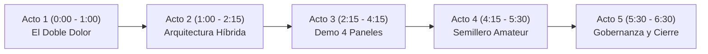

# 📊 Investigación de Benchmarks para IBM y Fundamentación del Semillero Amateur

**Proyecto:** OMNIMORPH v3 — Pitch, Storytelling & Presentation Pack  
**Repositorio:** `omnimorph-pitch-storytelling`  
**Rol:** `01 - Repo Setup & Research Scout`  
**Destinatarios:** Jurado de IBM (Maciel y directivos), equipo técnico (Roy y colaboradores) y comunidad del *IBM SkillsBuild AI Experiential Learning Lab México 2026*.

---

## 1. Psicología y Criterios del Jurado IBM: ¿Qué Hace Ganador a un Pitch?

El panel de evaluación corporativo y técnico de IBM (liderado por directivos de tecnología y mentores de watsonx) no busca un discurso de mercadotecnia hueco ni una colección de términos de moda. Buscan **arquitectura pragmática, viabilidad empresarial, rigor de gobernanza e impacto humano tangible**.

### 1.1. Los 5 Pilares de Evaluación en el Ecosistema IBM watsonx

| Pilar | Qué evalúa el jurado de IBM | Cómo responde Omnimorph |
| :--- | :--- | :--- |
| **1. Definición del Dolor Humano** | ¿El problema es real o es tecnología buscando una justificación? ¿Quién sufre hoy? | **Doble dolor:** En la élite, el analista deportivo ahogado en 40,000 coordenadas de telemetría sin traducción táctica en tiempo real. En la comunidad, el 95% del talento llanero que queda fuera del profesionalismo por falta de métricas y visorías sesgadas. |
| **2. Eficiencia Arquitectónica en IBM Cloud** | ¿Usan la nube con sensatez de costos o queman tokens llamando modelos masivos para todo? | **Flujo Híbrido Inteligente:** Percepción pesada de visión local/edge (GPU); orquestación y cálculo cinemático en CPU en IBM Cloud vía **watsonx Orchestrate ADK** (< 1.5 s de cómputo); e inferencia con **`ibm/granite-3-8b-instruct`** en ventanas tácticas de 4.0 s (< 500 bytes de carga útil, temperatura 0.3). |
| **3. Gobernanza, Ética y Trazabilidad** | ¿Hay alucinación? ¿Es auditable? ¿Cumplen licencias y seguridad de datos? | **Auditoría watsonx.governance activa (`Monitor M3`):** Registro en `governance_audit.jsonl` con latencia, tokens y costo en Resource Units. Validación cruzada de la narración contra métricas numéricas para evitar alucinaciones tácticas. Cero API keys en código y respeto a derechos broadcast. |
| **4. Demostración en Vivo Funcional** | ¿Funciona el software o muestran diapositivas estáticas con capturas simuladas? | **Dashboard Sincronizado de 4 Paneles (`Monitor M4`):** Reloj común `(frame, t)` con desfase < 40 ms mostrando: (1) Video con marcas, (2) Radar cenital 2D de 120×70 m, (3) Métricas de bloque y transición, y (4) Narración táctica de Granite 3 8B con síntesis de voz en español. |
| **5. Viabilidad de Negocio e Impacto Social** | ¿Hay mercado B2B y propósito social defendible? | **Doble vía de monetización e impacto:** B2B para clubes de media tabla, televisoras y academias; impacto social al democratizar el pasaporte métrico de talento en ligas amateurs de México y Latinoamérica. |

---

## 2. Estructura y Timing Óptimo del Pitch (5 a 7 Minutos)

Para mantener la atención de directivos y jurados técnicos sin perder profundidad, el tiempo se divide en **5 actos dinámicos**, reservando espacio clave para la interacción en vivo.



### Desglose Minuto a Minuto:

* **0:00 - 1:00 | Acto 1: El Gancho y el Doble Dolor Humano (1 minuto)**
  * *Atención:* 100% narrativa humana y contraste visual.
  * *Mensaje central:* El fútbol genera millones de datos por partido, pero casi nadie los entiende cuando rueda el balón. Mientras el analista de primera división se ahoga en 20 pestañas de datos numéricos en el medio tiempo, a 15 kilómetros de distancia un chico de 16 años juega en una cancha de tierra sin que nadie registre si corrió 8 kilómetros o si rompió 10 líneas de pase. El deporte tiene un problema de traducción y un problema de acceso.

* **1:00 - 2:15 | Acto 2: La Solución Omnimorph y el Ensamble Técnico con Roy (1 minuto 15 segundos)**
  * *Atención:* 60% arquitectura, 40% explicación conceptual.
  * *Mensaje central:* Omnimorph es el primer traductor táctico integral: convierte video estándar en radar métrico 2D y genera crónicas tácticas en tiempo real en español.
  * *Espacio modular de Roy (Visión y Modelado Físico):* Roy toma la palabra durante 45 segundos para explicar la contención matemática: homografía normalizada ($H/H_{2,2}$ con EMA adaptativo), algoritmo húngaro para re-identificar jugadores tras oclusiones, y derivadas de Savitzky-Golay con cota biológica estricta ($v \le 9.5\text{ m/s}$).
  * *Conexión con IBM Cloud:* Cómo esos datos estabilizados suben a IBM Cloud como una *Custom Python Tool* en **watsonx Orchestrate ADK**.

* **2:15 - 4:15 | Acto 3: La Demostración en Vivo de los 4 Paneles (2 minutos)**
  * *Atención:* 80% pantalla en vivo, 20% orador guiando los ojos del jurado.
  * *Acción:* Ejecución del Dashboard sincronizado bajo el reloj maestro `(frame, t)`:
    1. **Panel 1 (Video):** Se muestra el seguimiento de los jugadores y el balón en la jugada de $30\text{ s}$.
    2. **Panel 2 (Radar 2D):** La transformación cenital en tiempo real sobre la cancha de 120×70 metros, demostrando cómo los jugadores mantienen distancias sin saltos ni teletransportaciones.
    3. **Panel 3 (Métricas Tácticas de Ventana):** Altura de bloque defensivo, compacidad y velocidad de transición en la ventana activa de 4.0 segundos.
    4. **Panel 4 (Granite 3 8B + Audio):** La voz en español sintetizando el análisis táctico generado por `ibm/granite-3-8b-instruct`.
  * *Verificación visible:* Mostrar la barra de 9 semáforos de observabilidad (`M1` a `M4`) en estado `PASS`.

* **4:15 - 5:30 | Acto 4: Del Estadio al Llano — Democratización del Talento (1 minuto 15 segundos)**
  * *Atención:* 70% impacto social y datos de mercado, 30% visión a futuro.
  * *Mensaje central:* Wyscout y Catapult cuestan miles de dólares y requieren estadios equipados con cámaras cenitales o chalecos GPS. Omnimorph lleva esta capacidad a cualquier cancha con una sola toma de celular o cámara fija en tribuna. Explicación de los casos del "contención invisible" y el "delantero desasistido".

* **5:30 - 6:30 | Acto 5: Gobernanza, Modelo de Negocio y Cierre (1 minuto)**
  * *Atención:* 100% contundencia empresarial y llamado a la acción.
  * *Mensaje central:* Evidencia del archivo `governance_audit.jsonl` auditado por watsonx.governance. Modelo B2B para clubes de expansión/segunda división y modelo freemium/comunitario para ligas locales.
  * *Frase de impacto final:* *"El talento en México y América Latina no falta; lo que faltaba era un lente objetivo que lo hiciera visible. Con Omnimorph e IBM watsonx, democratizamos el análisis para que el próximo gran jugador no se quede en el anonimato."*

---

## 3. Radiografía del Fútbol Amateur: Las Barreras Invisibles del Semillero en México y Latinoamérica

Para defender el caso de negocio y de impacto social ante IBM, es fundamental comprender por qué el sistema actual de visorías en México está roto y cómo la tecnología de bajo costo es la única vía para repararlo.

### 3.1. Las 3 Barreras Estructurales del Talento Joven

```
                                      BARRERAS DEL TALENTO AMATEUR
                                                   │
         ┌─────────────────────────────────────────┼─────────────────────────────────────────┐
         ▼                                         ▼                                         ▼
   1. EL EMBUDO GEOGRÁFICO                  2. EL "OJO CLÍNICO" Y                     3. EL ABISMO TECNOLÓGICO
        Y ECONÓMICO                               SESGO HUMANO                            (CATAPULT / WYSCOUT)
  • 80% visorías en CDMX, GDL, MTY.       • Pruebas de 15 min con 200 jóvenes.      • Chalecos GPS: $2,000+ USD/año.
  • Costos de viaje insostenibles         • Sesgo hacia goles o altura física.      • Wyscout B2B: $3,000 - $10,000 USD.
    para familias de bajos recursos.      • Corrupción y "compadrazgo" informal.    • Inaccesible para 99% de ligas.
```

1. **El Embudo Geográfico y Económico:**
   - En México se juegan semanalmente más de **1.5 millones de partidos de fútbol amateur** en ligas dominicales, torneos de barrio ("talachas"), ligas municipales y canchas de llano (en zonas como Iztapalapa, Nezahualcóyotl, Ecatepec, el bajío, Sinaloa o Veracruz).
   - Sin embargo, las visorías formales de los clubes de Liga MX se concentran en un 80% en las tres principales metrópolis (CDMX, Guadalajara, Monterrey) o en torneos cerrados de academias de paga donde la mensualidad oscila entre **$1,500 y $4,500 MXN mensuales**. Un talento de escasos recursos en Oaxaca o la sierra de Guerrero simplemente nunca coincide en tiempo y espacio con un visor oficial.

2. **La Tiranía del "Ojo Clínico" y la Subjetividad:**
   - Cuando se abre una visoria masiva gratuita, se presentan entre **150 y 300 jóvenes** para ser observados en partidos de 15 a 20 minutos con camisetas numeradas al azar.
   - El visor humano, condicionado por la fatiga y el poco tiempo, incurre en sesgos cognitivos documentados:
     - **Sesgo del resultado inmediato:** Solo nota al delantero que anotó un gol o al extremo que hizo una gambeta vistosa.
     - **Sesgo antropométrico:** Favorece al joven de mayor desarrollo físico temprano sobre jugadores con mejor lectura táctica pero maduración biológica tardía.
     - **Falta de trazabilidad:** No hay registro de qué pasó en los 14 minutos en que el balón no estuvo cerca del jugador.

3. **El Abismo de Costos Tecnológicos (Inaccesibilidad de la Élite):**

| Herramienta / Sistema | Tipo de Solución | Costo Anual Estimado | Barrera de Adopción en Canchas de Barrio |
| :--- | :--- | :--- | :--- |
| **Catapult / STATSports** | Chalecos GPS + Sensores inerciales | **$1,800 – $2,500 USD** por jugador/año | Requiere comprar hardware individual, mantenimiento y estaciones de carga. Inviable para 22 jugadores de barrio. |
| **Wyscout / Hudl** | Plataforma de videoanálisis y base de datos B2B | **$3,000 – $10,000 USD** anuales por licencia | Solo indexa ligas profesionales o semiprofesionales organizadas. El fútbol de llano no existe en sus servidores. |
| **TRACAB / ChyronHego** | Cámaras ópticas fijas de estadio | **$50,000 – $150,000 USD** por instalación fija | Requiere infraestructura de fibra óptica y calibración en estadios con graderíos cerrados. |
| **OMNIMORPH (Nuestra propuesta)** | Visión por computadora híbrida + IBM watsonx | **$0 en hardware adicional** (un smartphone común en tripié) + centavos de nube por partido | Funciona sobre video 1080p estándar; extrae telemetría 2D estabilizada y genera un pasaporte táctico objetivo. |

---

## 4. Cómo Omnimorph Nivela la Cancha: El Pasaporte Táctico Objetivo

Omnimorph no necesita que el jugador use un chaleco de $2,000 dólares. A partir de una sola toma de video estándar grabada desde la banda o tribuna, el motor realiza las siguientes conversiones:

1. **De Píxeles a Metros Reales:** Mediante homografía proyectiva ($\hat{H}$), transforma el movimiento en pantalla a coordenadas cenitales métricas en un plano de 120×70 metros.
2. **De Caos Visual a Trazas Continuas:** Mediante el Algoritmo Húngaro y cierre transitivo, mantiene la identidad del jugador aunque se cruce con compañeros o árbitros.
3. **De Ruido a Fisiología:** Con el filtrado Savitzky-Golay, calcula velocidades reales ($m/s$), distancias recorridas y aceleraciones sin picos artificiales.
4. **De Números a Sentido Común:** **`ibm/granite-3-8b-instruct`** interpreta si el jugador mantuvo compacidad defensiva, si basculó oportunamente o si generó desmarques de ruptura, entregando un reporte redactado en lenguaje de entrenador profesional.

### 4.1. Honestidad Tecnológica: Estado Actual vs. Hoja de Ruta

Para ganarse la confianza de un jurado técnico de IBM, es indispensable ser rigurosos con lo que el prototipo hace hoy y cómo evoluciona en producción:

```
┌────────────────────────────────────────────────────────┐
│ ESTADO ACTUAL DEL MOTOR (Validado y Demostrable Hoy)   │
├────────────────────────────────────────────────────────┤
│ • Calibrado en clips broadcast de 1080p a 25 fps.      │
│ • Requiere líneas de cancha visibles para 32 keypoints.│
│ • Detecta y rastrea 22 jugadores, árbitros y balón.    │
│ • Filtro Savitzky-Golay con cota biológica v <= 9.5m/s.│
│ • Inferencia Granite 3 8B en ventanas de 4s (<500 B).  │
│ • Monitores M1 a M4 en PASS con desfase < 40 ms.       │
└───────────────────────────┬────────────────────────────┘
                            │
                            ▼
┌────────────────────────────────────────────────────────┐
│ HOJA DE RUTA A TERRENO AMATEUR (Siguiente Fase)        │
├────────────────────────────────────────────────────────┤
│ • Autocalibración de homografía con 4 marcas de esquina│
│   o postes para canchas con cal desgastada o tierra.   │
│ • Compensación dinámica de vibración para tripiés      │
│   de teléfono móvil en condiciones de viento.          │
│ • Mapeo de dorsales/chalecos de color único para       │
│   partidos sin uniformes contrastantes de catálogo.    │
│ • Generación del "Pasaporte Scout en PDF" descargable  │
│   para el jugador y su familia tras cada partido.      │
└────────────────────────────────────────────────────────┘
```

---

## 5. Casos de Estudio en Cancha: Cómo el Dato Revela al "Talento Fantasma"

Para el Pitch y el Storytelling, estos tres ejemplos concretos demuestran por qué la telemetría objetiva supera al "ojo clínico" tradicional en el fútbol llanero:

### Caso A: "El Contención Invisible" (Lectura Táctica vs. Espectáculo)
* **La situación en la visoria tradicional:** Mateo, 15 años, juega de mediocentro posicional en una visoria de 20 minutos. Su equipo empata 0-0. Mateo toca el balón únicamente 6 veces porque su función es temporizar y cerrar líneas de pase. El visor anota: *"Poca participación con balón, sin iniciativa ofensiva"* y lo descarta.
* **La revelación en Omnimorph:**
  * El radar cenital 2D demuestra que Mateo mantuvo al equipo en un bloque medio con compacidad de **18.4 metros** (promedio de élite).
  * Realizó **14 coberturas defensivas** que forzaron al rival a jugar hacia atrás.
  * Recorrió 2.4 km proyectados con un sprint pico de **7.8 m/s** al replegar tras pérdida.
* **El veredicto de Granite 3 8B:** *"Pivote con alto sentido de ubicación espacial; garantiza equilibrio defensivo y cierra el carril central aun sin posesión directa."* Mateo pasa de invisible a prospecto de alto valor táctico.

### Caso B: "El Extremo Desasistido" (Capacidad Física vs. Aislamiento Colectivo)
* **La situación en la visoria tradicional:** Kevin juega de extremo derecho en una liga de barrio. Su mediocampo es presionado y nunca logra conectarle un pase limpio. Termina el partido con 0 tiros a gol y 0 asistencias. El visor concluye: *"Sin peligro ofensivo"*.
* **La revelación en Omnimorph:**
  * Omnimorph registra que Kevin realizó **11 desmarques de ruptura** al espacio a más de **8.1 m/s** en 30 minutos.
  * Su velocidad punta alcanzó **8.9 m/s** ($32.0\text{ km/h}$, percentil 92 para su categoría de edad).
  * El problema no era el jugador, sino el proveedor del pase.
* **El veredicto de Granite 3 8B:** *"Delantero con aceleración sobresaliente y constante ataque a la espalda de la línea defensiva; subutilizado por desconexión en salida."*

### Caso C: "El Bloque Roto" (Detección Temprana de Errores de Conjunto)
* **La situación en el banquillo:** El entrenador amateur ve que le meten tres goles en el segundo tiempo y asume que "faltó garra o concentración".
* **La revelación en Omnimorph:**
  * La gráfica de compacidad revela que entre el minuto 20 y el 25 la distancia entre la última línea y los delanteros se estiró de **22 metros a 44 metros**, dejando un desierto en el mediocampo.
  * Granite 3 8B señala con precisión quirúrgica el momento y la zona del colapso estructural.

---

## 6. Integración Modular con la Participación Técnica de Roy

Para garantizar una presentación fluida donde Roy brille como líder técnico sin romper el hilo narrativo, se define la siguiente interfaz de entrega de palabra:

1. **Introducción del Presentador:**
   > *"Teníamos claro el problema humano. Pero para resolverlo no podíamos simplemente pedirle a un modelo de lenguaje que adivinara lo que pasa en un video. Necesitábamos física, geometría y computación visual de alto rendimiento. Para explicar cómo domesticamos este caos matemático, le cedo la palabra a Roy, nuestro líder técnico."*

2. **Bloque Técnico de Roy (45 a 60 segundos):**
   * **Problema P1 (La Cámara que tiembla):** *"Cuando la cámara se mueve, la proyección salta. Fijamos la escala proyectiva normalizando por $H_{2,2}$ y creamos un filtro exponencial adaptativo que pesa cuántos puntos clave están bien fundamentados. La proyección en cancha no salta: fluye."*
   * **Problema P3 (El Jugador que desaparece):** *"Cuando dos futbolistas se cruzan, los IDs parpadean. Modelamos esto como un problema de asignación óptima bipartita resuelto con el Algoritmo Húngaro y extrapolación cinemática. Si un jugador sale por un costado del tumulto, recuperamos su identidad."*
   * **Problema P2 (La Velocidad Imposible):** *"La derivada simple en video genera jugadores corriendo a 50 km/h por puro ruido de píxel. Aplicamos Savitzky-Golay con ventana de 5 cuadros y una cota fisiológica estricta de 9.5 m/s. Nadie en Omnimorph corre más rápido que un atleta olímpico."*

3. **Retorno al Presentador hacia IBM Cloud:**
   > *"Con estos datos matemáticamente limpios en milisegundos, subimos la carga a IBM Cloud. Y es ahí donde entra en juego la orquestación de watsonx y Granite 3 8B para darle voz y sentido al juego..."*

---

## 7. Conclusión del Scout para el Agente `02`

Este reporte deja fundamentados los dos pilares estratégicos de Omnimorph:
1. **La credibilidad ante IBM:** Demostrando que el proyecto entiende la economía de tokens, la gobernanza auditable y el valor de usar `watsonx Orchestrate ADK` y `ibm/granite-3-8b-instruct` como herramientas de ingeniería real.
2. **El corazón del producto:** Demostrando que no construimos una curiosidad estadística para equipos multimillonarios de Champions League, sino una herramienta de justicia deportiva que convierte cualquier video de celular en una oportunidad real para miles de jóvenes que hoy no son vistos.

El repositorio está listo, con Git configurado, directrices de tono en `GEMINI.md` y este respaldo de investigación para que `02 - Pitch & Storytelling Writer` redacte el borrador completo del Pitch Deck y la narrativa.
