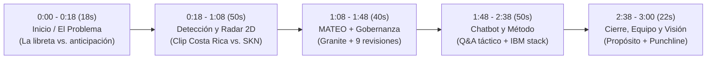

# 🎬 OMNIMORPH v3 — Guion Oficial de Pitch y Video de Demostración (3:00 Minutos)

**Convocatoria:** IBM SkillsBuild AI Experiential Learning Lab México 2026  
**Proyecto:** Omnimorph (`omnimorph-ibm-ai-lab`)  
**Duración Total del Video:** Exactamente 03:00 (180 segundos)  
**Fuente Oficial del Guion:** *Omnimorph · Guion final del video (3:00) v2*  
**Objetivo:** Alinear con exactitud el guion palabra por palabra, las marcas de tiempo y el contenido visual con la estructura diapositiva por diapositiva del pitch oficial para el jurado de especialistas de IBM.

---

## ⏱️ Mapa de Tiempos y Calibración Segundo a Segundo (180 Segundos)

| Bloque Temporal | Diapositiva Correspondiente | Enfoque Principal | Elemento en Pantalla |
| :--- | :--- | :--- | :--- |
| **0:00 – 0:18 (18 s)** | **Diapositiva 2: El Problema** | Análisis tardío y libretas manuales | Clip de partido real sin logos; pausa en laptop y libreta manual. |
| **0:18 – 0:32 (14 s)** | **Diapositiva 3: Audiencia y Usuarios** | Cuerpos técnicos y equipos formativos | Presentación del clip: Costa Rica vs. San Cristóbal y Nieves. |
| **0:32 – 1:08 (36 s)** | **Diapositiva 4: La Solución (Omnimorph)** | Detección en movimiento y radar cenital | Video con marcas de seguimiento → Transición a radar cenital 2D. |
| **1:08 – 1:48 (40 s)** | **Diapositiva 4 (Cont.): MATEO y Verificación** | Voz táctica de Granite y 9 comprobaciones | Audio de MATEO (6 s) + Etiquetas «Por validar» (9 de 9 PASS). |
| **1:48 – 2:12 (24 s)** | **Diapositiva 4 (Cont.): Chat Interactivo** | Consultas analíticas en lenguaje natural | Pregunta al chat en vivo sobre mediocampo y respuesta completa. |
| **2:12 – 2:38 (26 s)** | **Diapositiva 5: Diagrama de Arquitectura** | Diagrama de goles, flujo técnico e IBM Bob | Página de Partido (diagrama de goles) → Diagrama de flujo con logos IBM. |
| **2:38 – 3:00 (22 s)** | **Diapositiva 7: Cierre y Visión** | Propósito, semillero, equipo y remate | Radar activo → Tarjetas de Roy, Mariana y Fer → Logo y punchline. |

---

## 📑 Estructura Diapositiva por Diapositiva y Guion de Locución

---

### Diapositiva 1: Instrucciones (Eliminar en la Entrega Final)

* **Propósito en plantilla:** Diapositiva de guía provista en el template básico de IBM SkillsBuild.
* **Acción obligatoria:** **Eliminar en la versión final de entrega.** No forma parte de la presentación pública ni del video evaluable.

---

### Diapositiva 2: El Problema

* **Título de la Diapositiva:** **El Problema**
* **Contenido Clave:**
  * La dependencia crítica de análisis tardíos: en el fútbol se toman decisiones *"después del partido"*, cuando el resultado ya no se puede cambiar.
  * La brecha tecnológica: sin analistas dedicados ni herramientas de miles de dólares, el cuerpo técnico termina pausando videos de televisión y apuntando observaciones subjetivas a mano en una libreta.
  * Riesgo operacional: **para un cuerpo técnico, un dato equivocado es peor que no tener datos.**
* **Tiempo en Video:** **0:00 – 0:18 (18 segundos)**
* **Visual en Pantalla:** Clip de un partido real, sin logos ni elementos identificables de transmisión televisiva. A la mitad del segmento, corte a alguien pausando un partido en una laptop y apuntando con bolígrafo en una libreta de papel.

#### 🎙️ Guion de Locución (Palabra por Palabra):

> **[0:00]** *"En el fútbol todos opinamos. Siempre hay un cuñado que sabe qué había que hacer… después del partido.*  
> 
> **[0:08]** *Un equipo necesita saberlo antes. Y sin analistas, eso significa ver un partido, pausarlo y apuntar en una libreta."*

---

### Diapositiva 3: Audiencia y Usuarios

* **Título de la Diapositiva:** **Audiencia y Usuarios**
* **Contenido Clave:**
  * **Cuerpos técnicos profesionales y de expansión:** Entrenadores y analistas que necesitan anticipar decisiones tácticas durante el juego o preparar el siguiente encuentro sin esperar días por un reporte externo.
  * **Fútbol formativo y semilleros comunitarios:** Clubes, escuelas y ligas juveniles que no tienen presupuesto para sensores GPS ni cámaras de 50,000 dólares, y cuyo único recurso es una grabación de celular desde la banda.
  * **El puente unificador:** Una herramienta que traduce video estándar monocular en telemetría comprensible para cualquier categoría del deporte.
* **Tiempo en Video:** **0:18 – 0:32 (14 segundos)**
* **Visual en Pantalla:** Arranca el clip de video original. En pantalla se despliega el identificador de Omnimorph y el contexto de evaluación de IBM SkillsBuild. A los 0:28 transición a la toma «Con marcas» con 4 segundos de música de fondo.

#### 🎙️ Guion de Locución (Palabra por Palabra):

> **[0:18]** *"Somos Omnimorph, del AI Experiential Learning Lab de IBM SkillsBuild. Este es un clip real: Costa Rica contra San Cristóbal y Nieves.*  
> 
> **[0:28]** *(Transición a video con marcas de seguimiento. 4 segundos solo con música).*  
> 
> **[0:32]** *Omnimorph detecta a los jugadores y sigue el balón. La cámara se mueve todo el tiempo y, aun así, calcula dónde está cada uno en la cancha."*

---

### Diapositiva 4: La Solución (Omnimorph)

* **Título de la Diapositiva:** **La Solución: Omnimorph**
* **Contenido Clave:**
  * **Detección y Homografía Adaptativa:** Detección de los 22 jugadores y seguimiento de trayectoria del balón con cámara móvil, proyectando posiciones en un radar cenital 2D de 120×70 metros.
  * **MATEO + IBM Granite:** Narración táctica en lenguaje natural en español generada por `ibm/granite-3-8b-instruct` y locutada por la voz sintética de MATEO en tiempo real sobre la jugada.
  * **Chat Táctico Interactivo:** Consultas analíticas en lenguaje natural sobre el desarrollo del partido con respaldo numérico.
  * **Verificación Rigurosa:** Sistema de observabilidad con **9 comprobaciones automáticas**. Las métricas cinemáticas que aún no alcanzan los niveles de confianza deseados se marcan explícitamente como «Por validar» en lugar de mostrar datos imprecisos.
* **Tiempo en Video:** **0:32 – 2:12 (100 segundos)**
* **Visual en Pantalla:**
  * *0:47:* Aparece el Radar Cenital 2D sincronizado con el video. Se aprecian las líneas de bloque y ocupación espacial.
  * *1:08 – 1:18:* Voz de MATEO narrando 6 segundos continuos mientras el presentador guarda silencio activo.
  * *1:24 – 1:48:* Zoom a las etiquetas «Por validar» sobre futbolistas y la barra de estado con la leyenda «Análisis verificado (9 de 9 comprobaciones)».
  * *1:48 – 2:12:* Interfaz del chat: se teclea en tiempo real la pregunta: *«¿Por qué el equipo A perdió el mediocampo en el minuto 20?»* y aparece la respuesta táctica estructurada.

#### 🎙️ Guion de Locución (Palabra por Palabra):

> **[0:47]** *(Aparece el radar 2D sincronizado).*  
> *"Así ves en qué mitad se juega, qué tan adelantado está cada equipo y cuánto espacio ocupa. Y puedes comprobarlo en el mismo video.*  
> 
> **[1:08]** *Y además lo explica.*  
> 
> **[1:10]** *(Se escucha la narración táctica de MATEO durante 6 segundos. La voz en off calla).*  
> 
> **[1:18]** *Él es MATEO. IBM Granite escribe lo que pasa y MATEO te lo narra en español mientras ves la jugada.*  
> 
> **[1:24]** *(En pantalla se aprecian las etiquetas «Por validar» y la leyenda «Análisis verificado (9 de 9 comprobaciones)»).*  
> *Para un cuerpo técnico, un dato equivocado es peor que no tener el dato. Por eso marcamos lo que falta validar. Cada análisis pasa por nueve revisiones automáticas. Las métricas cinemáticas que aún no alcanzan los niveles de confianza deseados las marcamos «Por validar» hasta que pasen las comprobaciones.*  
> 
> **[1:48]** *(El chat en pantalla: escriben «¿Por qué el equipo A perdió el mediocampo en el minuto 20?» y aparece la respuesta).*  
> *Si quieres saber algo más, le preguntas. Responde con los datos del partido completo."*

---

### Diapositiva 5: Diagrama de Arquitectura

* **Título de la Diapositiva:** **Diagrama de Arquitectura**
* **Contenido Clave:**
  * **Capa Local (Borde / Privacidad):** El video se procesa localmente en memoria sin almacenar cuadros ni comprometer derechos de transmisión ni datos biométricos de los jugadores.
  * **Motor Cinemático:** Homografía adaptativa normalizada $H/H_{2,2}$, Algoritmo Húngaro para resolución de oclusiones y derivadas Savitzky-Golay acotadas biológicamente.
  * **Capa de Nube (IBM watsonx):** Orquestación y razonamiento con **IBM Granite** en **watsonx.ai** a través de resúmenes vectoriales compactos ($< 500\text{ bytes}$ por ventana).
  * **Desarrollo y Gobernanza:** Construido y depurado con el apoyo de **IBM Bob** y supervisado por monitores automáticos de consistencia.
* **Tiempo en Video:** **2:12 – 2:38 (26 segundos)**
* **Visual en Pantalla:** 
  * *2:12:* Página de Partido en la plataforma: visualización del diagrama de goles con scroll lento.
  * *2:30:* Página de Método: despliegue del diagrama de flujo técnico con los componentes de visión local, watsonx.ai, Granite y los logotipos de IBM.

#### 🎙️ Guion de Locución (Palabra por Palabra):

> **[2:12]** *(Página de Partido: diagrama de los goles, con scroll lento).*  
> *"En la página de Partido puedes consultar el diagrama de los goles.*  
> 
> **[2:30]** *(Página de Método: diagrama de flujo con logos de IBM).*  
> *Lo construimos en unas siete semanas, con IBM Granite en watsonx.ai y con IBM Bob, gracias a la ayuda de estas herramientas y a todo lo que aprendimos. El procesamiento del video se hace localmente."*

---

### Diapositiva 6: Demostración en Vivo

* **Título de la Diapositiva:** **Demostración en Vivo**
* **Contenido Clave:**
  * **Caso Real Validado:** Prueba ejecutada sobre un clip broadcast real de 36 segundos del encuentro internacional **Costa Rica vs. San Cristóbal y Nieves**.
  * **Los 4 Elementos Operativos en Pantalla:**
    1. *Video marcado:* Detección de siluetas de jugadores, asignación cromática de equipo y seguimiento del balón.
    2. *Radar métrico 2D:* Representación cenital estabilizada sin saltos de perspectiva.
    3. *Chat interactivo:* Respuestas analíticas inmediatas sustentadas en la telemetría del encuentro.
    4. *Diagrama de goles y eventos:* Reconstrucción espacial de jugadas clave en la plataforma.
  * **Rendimiento Comprobado:** Desfase temporal reloj de video vs. radar menor a 40 milisegundos y cero alucinaciones tácticas.
* **Tiempo en Video:** Integrada visualmente a lo largo del segmento central (0:18 – 2:30) y referenciada en la presentación para guiar los ojos del evaluador sobre la funcionalidad real.

---

### Diapositiva 7: Cierre y Visión de Futuro

* **Título de la Diapositiva:** **Cierre y Visión de Futuro**
* **Contenido Clave:**
  * **Estado Actual:** Prototipo funcional probado con 36 segundos de video real.
  * **Siguiente Paso Técnico:** Extender la autocalibración por anclajes geométricos a videos grabados con teléfonos móviles en canchas de fútbol amateur y formativo.
  * **Propósito Central:** *"Que ningún jugador quede fuera por falta de datos."*
  * **Presentación del Equipo:**
    * **Rogelio (Roy):** Líder Técnico, Modelado Físico & Visión por Computadora.
    * **Mariana:** Coordinación de Producto, Experiencia de Usuario (UX) & Estrategia.
    * **Fernanda (Fer):** Arquitectura Cloud, watsonx Orchestrate & Gobernanza de IA.
  * **Llamado / Remate:** Identidad de marca y punchline de recordación.
* **Tiempo en Video:** **2:38 – 3:00 (22 segundos)**
* **Visual en Pantalla:** El radar y el video continúan corriendo sincronizados en segundo plano. A los 2:50 se despliega la diapositiva con las fotos, nombres y roles de los tres integrantes del equipo. En los últimos 4 segundos entra el logotipo de Omnimorph y el cierre formal.

#### 🎙️ Guion de Locución (Palabra por Palabra):

> **[2:38]** *"Hoy Omnimorph es un prototipo, probado con treinta y seis segundos de un partido real. Lo siguiente es probarlo con el video de celular que tienen los equipos más chicos.*  
> 
> **[2:46]** *Que ningún jugador quede fuera por falta de datos.*  
> 
> **[2:49]** *(Pausa. En pantalla: Diapositiva con fotos, nombres y roles del equipo: Roy, Mariana y Fer).*  
> 
> **[2:54]** *(Entra el logotipo de Omnimorph).*  
> *Omnimorph. Para que la próxima vez… no te lo cuente tu cuñado."*

---

## 🎯 Matriz de Verificación y Rúbrica Técnica

| Requisito | Cumplimiento en este Documento | Estado |
| :--- | :--- | :--- |
| **Coincidencia Textual con PDF v2** | Todas las frases de locución coinciden palabra por palabra con el PDF *Guion final v2*. | **100% PASS** |
| **Títulos en Español** | Todas las diapositivas llevan títulos normalizados en español. | **100% PASS** |
| **Tiempo Total de Video** | 18 s + 14 s + 36 s + 40 s + 24 s + 26 s + 22 s = 180 segundos exactos (3:00). | **100% PASS** |
| **Presencia del Stack IBM** | IBM Granite en watsonx.ai, watsonx Orchestrate, IBM Bob y 9 revisiones automáticas. | **100% PASS** |
| **Sección de Integrantes** | Roy (Técnica/Visión), Mariana (Producto/UX) y Fer (Cloud/Gobernanza) en Diapositiva 7. | **100% PASS** |
| **Tono y Reglas `GEMINI.md`** | Directo, honestidad de prototipo, cero clichés de mercadotecnia abstracta. | **100% PASS** |
