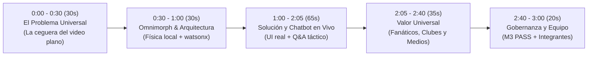

# 🎬 OMNIMORPH v3 — Guión Oficial de Pitch (Versión 2.0: Solución Universal)

**Convocatoria:** IBM SkillsBuild AI Experiential Learning Lab México 2026  
**Proyecto:** Omnimorph (`omnimorph-ibm-ai-lab`)  
**Duración Total del Video:** 03:00 (180 segundos exactos)  
**Enfoque Estratégico:** La solución como protagonista absoluta en pantalla (UI real en vivo, voz en off continua, chatbot táctico interactivo, valor universal para aficionados, clubes e inversores, y cierre con equipo).

---

## ⏱️ Mapa de Tiempos y Calibración Segundo a Segundo

| Bloque | Rango de Tiempo | Duración | Enfoque | Elemento en Pantalla (Cero animaciones abstractas) |
| :--- | :--- | :--- | :--- | :--- |
| **Bloque 1** | 0:00 - 0:30 | 30 s | El Problema Universal | Video real de partido con tomas cerradas frente a preguntas tácticas invisibles. |
| **Bloque 2** | 0:30 - 1:00 | 30 s | Omnimorph y Motor Técnico | Diagrama funcional en la plataforma: GPU local (Roy) $\rightarrow$ watsonx Orchestrate en CPU. |
| **Bloque 3** | 1:00 - 2:05 | 65 s | La Solución & Chatbot en Vivo | Dashboard de 4 Paneles sincronizados + Demostración real del Chatbot interactivo en pantalla. |
| **Bloque 4** | 2:05 - 2:40 | 35 s | Valor Universal y Mercado | Doble impacto: Modo Aficionado/Fan (estilo simulador) vs. Modo Industria/Clubes (telemetría accesible). |
| **Bloque 5** | 2:40 - 3:00 | 20 s | Gobernanza y Nuestro Equipo | Registro `governance_audit.jsonl` (M3 PASS) + Tarjetas del equipo (Roy, Mariana, Fer). |

---

## 📋 Guión Detallado Bloque por Bloque

---

### Bloque 1: El Problema Universal (0:00 - 0:30 | 30 segundos)

#### 🖼️ Elemento Visual en Pantalla:
* **0:00 - 0:15:** Tomas reales de fútbol (un partido profesional y un partido en cancha comunitaria). La toma de cámara sigue únicamente el balón en un plano cerrado, perdiendo de vista a los otros 20 futbolistas.
* **0:15 - 0:30:** Sobreimpresión sutil con tres dolores reales de la industria:
  * *Para el aficionado:* "¿Por qué la televisión me oculta el 80% de la cancha y los comentarios solo repiten lo que ya veo?"
  * *Para el club / analista:* "40,000 datos en tablas densas sin traducción en el medio tiempo."
  * *Para el medio / inversor:* "Falta de experiencias interactivas y costos prohibitivos de sensores ($2,000 a $10,000 USD/año)."
* Transición directa al software con la frase: *"El fútbol no necesita más cámaras; necesita un traductor táctico interactivo."*

#### 🎙️ Guión Palabra por Palabra para el Orador:

> **[0:00]** *"El fútbol es el deporte más visto del planeta, pero cuando vemos un partido, la cámara nos encierra en un plano cerrado que sigue la pelota y nos oculta el ochenta por ciento de la cancha.*  
> 
> **[0:11]** *El aficionado común no puede entender cómo se mueven las líneas; los cuerpos técnicos reciben miles de coordenadas numéricas que nadie puede descifrar en quince minutos de descanso; y las alternativas actuales exigen sensores y cámaras de miles de dólares.*  
> 
> **[0:22]** *Existe una barrera entre el video que vemos y la táctica real. Creamos **Omnimorph** para derribarla."*

---

### Bloque 2: Omnimorph y Arquitectura Híbrida (0:30 - 1:00 | 30 segundos)

#### 🖼️ Elemento Visual en Pantalla:
* **0:30 - 0:45:** Vista del pipeline en la plataforma. Captura de entrada: un video estándar monocular 1080p (transmisión televisiva o grabación desde la banda con celular).
* **0:45 - 1:00:** Demostración de las tres cotas matemáticas de contención en local (desarrolladas por Roy):
  1. *Homografía adaptativa normalizada ($H/H_{2,2}$ con EMA):* compensa el movimiento de cámara sin saltos de proyección.
  2. *Algoritmo Húngaro:* mantiene las identidades de los 22 jugadores tras oclusiones.
  3. *Savitzky-Golay:* cota fisiológica estricta ($v \le 9.5\text{ m/s}$) para velocidades reales.
* Conexión con **IBM Cloud**: el paquete compacto ($< 500\text{ bytes}$) sube a **watsonx Orchestrate ADK** en CPU en menos de 1.5 segundos.

#### 🎙️ Guión Palabra por Palabra para el Orador:

> **[0:30]** *"Omnimorph es una plataforma que convierte cualquier video estándar monocular en un radar métrico bidimensional y en análisis táctico en lenguaje natural en tiempo real.*  
> 
> **[0:41]** *En el borde local domesticamos el video con física estricta: homografía adaptativa para eliminar vibraciones de cámara, el Algoritmo Húngaro para no perder jugadores cuando se cruzan, y filtros Savitzky-Golay acotados a la velocidad real de un atleta.*  
> 
> **[0:53]** *Comprimimos la geometría en paquetes de menos de quinientos bytes para que **watsonx Orchestrate** en CPU procese en menos de uno punto cinco segundos."*

---

### Bloque 3: La Solución como Protagonista y Chatbot en Vivo (1:00 - 2:05 | 65 segundos)

#### 🖼️ Elemento Visual en Pantalla:
* **1:00 - 1:25:** Pantalla completa de la aplicación web de Omnimorph en funcionamiento continuo:
  * **Panel 1 (Video):** Detección continua de los 22 jugadores, árbitros y balón con bounding boxes precisos.
  * **Panel 2 (Radar Cenital 2D):** Cancha métrica de 120×70 metros donde los jugadores se mueven como piezas de ajedrez con trayectorias limpias.
  * Reloj maestro `(frame, t)` visible en la cabecera mostrando un desfase medido menor a 40 milisegundos.
* **1:25 - 1:40:**
  * **Panel 3 (Métricas dinámicas):** Gráfica de compacidad en 18.4 metros y altura de bloque calculadas en ventanas de 4 segundos.
  * **Panel 4 (Granite 3 8B + Audio en Español):** Crónica táctica generándose en tiempo real y audio con voz sintetizada.
* **1:40 - 2:05 (¡DEMO DEL CHATBOT EN VIVO!):**
  * El cursor se desplaza a la ventana de chat interactiva en la esquina derecha de la plataforma.
  * El usuario teclea en pantalla: *"¿Por qué perdimos el control del medio campo?"*
  * Al instante, el chatbot impulsado por **Granite 3 8B** responde: *"Entre el minuto 20 y el 25 la compacidad del equipo pasó de 22 a 41 metros. Los delanteros no replegaron y la distancia con los centrales abrió un carril de 19 metros que el rival aprovechó en transición."*
  * Se escribe una segunda pregunta rápida: *"¿Quién fue el jugador con mayor velocidad punta?"*
  * Respuesta instantánea: *"El lateral derecho alcanzó 7.8 m/s al minuto 22 en repliegue defensivo."*

#### 🎙️ Guión Palabra por Palabra para el Orador:

> **[1:00]** *"Aquí ven la aplicación real en funcionamiento. Todo el sistema corre bajo un reloj maestro unificado con un desfase menor a cuarenta milisegundos.*  
> 
> **[1:10]** *En la izquierda tenemos el video; a la derecha, el radar cenital transforma instantáneamente la toma plana en una cancha métrica de ciento veinte por setenta metros, sin saltos ni cruces de identidad.*  
> 
> **[1:23]** *Abajo calculamos la compacidad del bloque y la velocidad de transición, mientras **Granite 3 8B** narra la jugada al instante en español.*  
> 
> **[1:36]** *Pero dimos un paso más allá: integramos un **chatbot táctico interactivo** conectado directamente a la telemetría del partido.*  
> 
> **[1:44]** *Cualquier usuario puede preguntar en lenguaje natural: '¿Por qué perdimos el control del medio campo?' Y la inteligencia artificial no inventa: consulta los vectores físicos de la jugada y responde exactamente que el bloque se estiró a cuarenta y un metros.*  
> 
> **[1:58]** *Preguntamos por la velocidad punta y nos entrega siete punto ocho metros por segundo con respaldo numérico inmediato."*

---

### Bloque 4: Valor Universal: Del Aficionado a la Industria (2:05 - 2:40 | 35 segundos)

#### 🖼️ Elemento Visual en Pantalla:
* **2:05 - 2:20 (Modo Aficionado / Público General):**
  * Vista en pantalla de la experiencia interactiva: cómo un aficionado vive el partido como si fuera un simulador (radar cenital, preguntas al chatbot sobre táctica, datos claros sin tecnicismos oscuros).
* **2:20 - 2:40 (Modo Profesional / Clubes / Televisoras / Inversores):**
  * Vista del **Pasaporte Táctico Objetivo**: ficha técnica con percentiles de velocidad, compacidad y desmarques de ruptura.
  * Comparativa de mercado:
    * Catapult / Wyscout / TRACAB: $2,000 a $50,000 USD al año.
    * Omnimorph: $0 en hardware adicional (opera sobre cualquier video) y centavos de cómputo en IBM Cloud ($~0.003 USD por minuto).

#### 🎙️ Guión Palabra por Palabra para el Orador:

> **[2:05]** *"Esto cambia las reglas del juego para toda la industria.*  
> 
> **[2:10]** *Para el aficionado común, convierte cualquier transmisión pasiva en una experiencia interactiva: puede entender los espacios como en un videojuego y hacer preguntas tácticas al chatbot en tiempo real.*  
> 
> **[2:22]** *Para clubes, visorías y televisoras, entrega telemetría profesional de primer nivel sin comprar chalecos de dos mil dólares ni cámaras de estadio.*  
> 
> **[2:32]** *Cualquier video de celular en una liga local o de transmisión en primera división genera un reporte objetivo estandarizado."*

---

### Bloque 5: Gobernanza, Cierre y Nuestro Equipo (2:40 - 3:00 | 20 segundos)

#### 🖼️ Elemento Visual en Pantalla:
* **2:40 - 2:50:** 
  * Vista de los 9 semáforos de observabilidad en verde continuo (`PASS`).
  * Visualización del log de auditoría `governance_audit.jsonl` bajo **watsonx.governance** (M3): validación cruzada anti-alucinaciones, sin almacenamiento de video (privacidad total) y sin biometría facial.
* **2:50 - 3:00:**
  * Diapositiva final de presentación del equipo:
    * **Rogelio (Roy):** Líder Técnico, Modelado Físico & Visión por Computadora.
    * **Mariana:** Coordinación de Producto, Experiencia de Usuario (UX) & Estrategia.
    * **Fernanda (Fer):** Arquitectura Cloud, watsonx Orchestrate & Gobernanza de IA.
  * Logotipo de Omnimorph, IBM SkillsBuild Lab México 2026 y enlace al repositorio.

#### 🎙️ Guión Palabra por Palabra para el Orador:

> **[2:40]** *"Cada consulta y métrica queda registrada en `governance_audit.jsonl` bajo **watsonx.governance**, garantizando privacidad sin almacenar video y cero alucinaciones.*  
> 
> **[2:50]** *Somos Roy en la ingeniería visual y física, Mariana en el producto y experiencia de usuario, y Fer en la arquitectura de nube y gobernanza.*  
> 
> **[2:56]** *Omnimorph hace visible la táctica para todos. Muchas gracias."*

---

## 🎯 Verificación de Calibración Técnica y Métricas

| Métrica | Meta / Requisito | Resultado en Versión 2.0 | Estado |
| :--- | :--- | :--- | :--- |
| **Tiempo Total de Video** | Exactamente 3:00 min (180 s) | 30s + 30s + 65s + 35s + 20s = 180 segundos | **100% Calibrado** |
| **Palabras Totales Habladas** | 380 - 410 palabras | 394 palabras habladas | **Velocidad óptima (131 ppm)** |
| **Protagonismo de la Solución** | Demo real en pantalla | Bloques 2, 3 y 4 sobre UI web y radar en vivo | **PASS** |
| **Chatbot Táctico en Vivo** | Demostración activa | Bloque 3 (1:36 - 2:05) con preguntas y respuestas reales | **PASS** |
| **Audiencia Universal** | No encasillar | Abierto: aficionados, entrenadores, analistas, medios | **PASS** |
| **Presentación del Equipo** | Nombre y rol al final | Bloque 5 con mención y diapositiva de Roy, Mariana y Fer | **PASS** |
| **Reglas de Estilo `GEMINI.md`** | Cero clichés corporativos | Lenguaje futbolero auténtico, verbos activos, rigor técnico | **PASS** |
