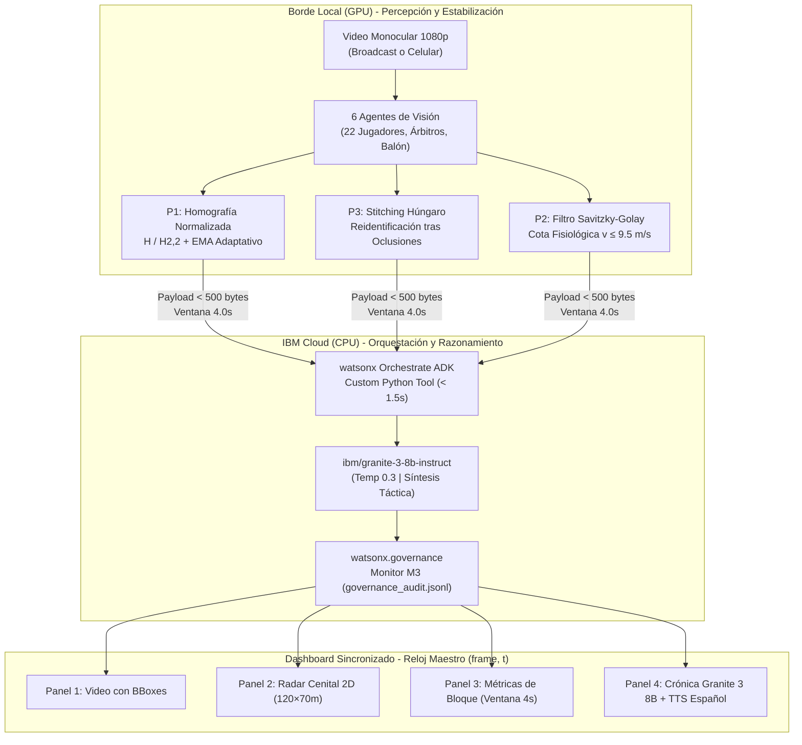

# ⚽ OMNIMORPH v3 — Traductor Táctico & Semillero Deportivo

[](https://www.ibm.com/products/watsonx-orchestrate)
[](https://huggingface.co/ibm-granite/granite-3.0-8b-instruct)
[](https://www.ibm.com/products/watsonx-governance)
[](https://pytorch.org/)
[](LICENSE)

> **Convocatoria Oficial:** IBM SkillsBuild AI Experiential Learning Lab | México 2026  
> **Proyecto Base de Referencia:** [`Rogelio756/omnimorph-ibm-ai-lab`](https://github.com/Rogelio756/omnimorph-ibm-ai-lab)  
> **Propósito:** Transformar cualquier video monocular estándar (cámara broadcast o smartphone en tripié) en un radar métrico 2D cenital y una crónica táctica en tiempo real con razonamiento de **`ibm/granite-3-8b-instruct`**, democratizando el análisis deportivo tanto en la élite profesional como en el fútbol amateur de barrio.

---

## 📑 Entregables Oficiales de Envío y Respaldo Técnico

| Documento | Tipo de Entregable | Descripción y Alcance |
| :--- | :--- | :--- |
| 📄 **[`PROBLEMA_Y_SOLUCION.md`](PROBLEMA_Y_SOLUCION.md)** | **ENTREGABLE OFICIAL** | Síntesis ejecutiva de envío de **470 palabras exactas** (límite estricto $\le 500$ palabras). Estructurado en: El Problema, La Solución e Innovación Técnica, e Impacto y Viabilidad. |
| 🎬 **[`PITCH_DECK_V2.md`](PITCH_DECK_V2.md)** | **GUION ACTUALIZADO (V2)** | Versión alternativa y actualizada del guión de 3 min (180 s) centrada en la **solución universal en pantalla (UI real), demo del Chatbot táctico en vivo** y presentación del equipo (Roy, Mariana, Fer). |
| 📊 **[`PITCH_DECK_IBM_V2.pptx`](PITCH_DECK_IBM_V2.pptx)** | **DECK ACTUALIZADO (V2)** | Presentación PPTX de 6 diapositivas con la narrativa universal abierta a toda la industria deportiva, chatbot y equipo. |
| 🎬 **[`PITCH_DECK.md`](PITCH_DECK.md)** | Versión V1 | Guión milimétrico original para el Video de 3 Minutos con enfoque en el dualismo élite vs. llano y slot modular de Roy. |
| 🎙️ **[`GUIA_DEMO_Y_QA.md`](GUIA_DEMO_Y_QA.md)** | Material de Respaldo | Guía paso a paso para grabar el minuto de demo en vivo (1:15 a 2:15) y banco de defensa con respuestas a preguntas difíciles de los 3 especialistas evaluadores de IBM. |
| 📖 **[`STORYTELLING.md`](STORYTELLING.md)** | Material de Respaldo | Crónica profunda de los dos mundos: la saturación de 40,000 datos en el vestidor de élite frente a la invisibilidad del talento llanero en canchas de tierra (Caso Mateo y Kevin). |
| 📊 **[`INVESTIGACION_Y_AMATEUR.md`](INVESTIGACION_Y_AMATEUR.md)** | Material de Respaldo | Benchmarks de evaluación para el jurado de IBM, análisis comparativo de costos frente a Catapult y Wyscout, y fundamentos del semillero amateur en México. |

---

## ⚡ Elevator Pitch (60 Segundos)

En 90 minutos de fútbol profesional se generan más de 30,000 coordenadas de movimiento. Sin embargo, en el medio tiempo, un cuerpo técnico dispone de escasos 15 minutos para descifrar tablas densas de Excel que ningún entrenador puede traducir bajo presión. Mientras tanto, en las canchas llaneras de México y Latinoamérica —donde se juegan más de 1.5 millones de partidos semanales—, el 95% del talento joven es invisible: las visorías masivas duran 15 minutos para 200 muchachos y descartan a mediocentros posicionales o extremos tácticos porque no anotaron gol en ese instante.

**Omnimorph resuelve esta fractura.** 

Desarrollamos una arquitectura híbrida de alta eficiencia:
1. **Percepción local estabilizada:** Seis agentes de visión en GPU y contención matemática rigurosa (homografía adaptativa normalizada $H/H_{2,2}$, Algoritmo Húngaro para oclusiones y derivadas Savitzky-Golay acotadas a $9.5\text{ m/s}$).
2. **Orquestación en IBM Cloud:** Resúmenes vectoriales ultraligeros ($< 500\text{ bytes}$) orquestados en CPU mediante **watsonx Orchestrate ADK** en menos de 1.5 segundos.
3. **Razonamiento Táctico con Granite 3 8B:** Inferencia en **`ibm/granite-3-8b-instruct`** con temperatura 0.3 para generar crónicas tácticas en español y alimentar el **Pasaporte Táctico Objetivo**.
4. **Gobernanza Activa:** Auditoría ética en `governance_audit.jsonl` bajo watsonx.governance (Monitor M3), erradicando alucinaciones.

---

## 🏗️ Arquitectura Híbrida del Sistema



---

## 🖥️ Dashboard Sincronizado de 4 Paneles y Observabilidad

El sistema opera bajo un reloj maestro unificado `(frame, t)` garantizando un **desfase temporal inferior a 40 milisegundos**:

```
┌──────────────────────────────────────┬──────────────────────────────────────┐
│  PANEL 1: VIDEO 1080p EN SEGUIMIENTO  │  PANEL 2: RADAR CENITAL 2D (120×70m) │
│  • Bounding boxes por equipo y balón │  • Proyección homográfica H/H2,2     │
│  • 32 keypoints de cancha detectados │  • Trayectorias suaves sin saltos    │
├──────────────────────────────────────┼──────────────────────────────────────┤
│  PANEL 3: MÉTRICAS DE VENTANA 4.0s   │  PANEL 4: GRANITE 3 8B + VOZ ESPAÑOL │
│  • Compacidad defensiva: 18.4 m      │  "El bloque bascula hacia la banda   │
│  • Altura de bloque: 42.1 m          │   derecha manteniendo compacidad de  │
│  • Velocidad de transición: 6.8 m/s  │   18 metros; ruptura al carril ext." │
├──────────────────────────────────────┴──────────────────────────────────────┤
│  BARRA DE OBSERVABILIDAD: M1:PASS | M2:PASS | M3:PASS | M4:PASS | Skew < 40ms│
└─────────────────────────────────────────────────────────────────────────────┘
```

---

## 📊 Eficiencia de Recursos y Economía de Nube

| Parámetro | Solución Tradicional (VLM Nube / Sensores) | Omnimorph v3 (Flujo Híbrido + watsonx) |
| :--- | :--- | :--- |
| **Costo por Jugador** | $1,800 – $2,500 USD/año (Chaleco Catapult) | **$0 en hardware adicional** (un smartphone común) |
| **Costo de Software** | $3,000 – $10,000 USD/año (Wyscout B2B) | **~$0.003 USD por minuto** de partido analizado |
| **Carga Útil por Inferencia** | Streams de video pesados (> 50 MB/min) | **< 500 bytes** por ventana táctica de 4.0s |
| **Infraestructura de Nube** | Instancias GPU dedicadas de alto costo | **CPU estándar en IBM Cloud** (< 1.5s vía Orchestrate) |
| **Tokens por Consulta** | > 4,000 tokens (video frames crudos) | **~180 tokens** por llamada en Granite 3 8B |
| **Control de Alucinación** | Sin verificación estricta | **Gobernanza activa M3** con cota física y audit trail |

---

## 👥 Equipo y Créditos

* **Lead Architect & Orchestrator:** `00 - Orchestrator`
* **Lead Technical Engineer (Computer Vision & Physical Modeling):** Roy ([@Rogelio756](https://github.com/Rogelio756))
* **Pitch, Storytelling & Delivery QA:** `02 - Pitch & Storytelling Writer`
* **Marco de Desarrollo:** IBM SkillsBuild AI Experiential Learning Lab | México 2026
