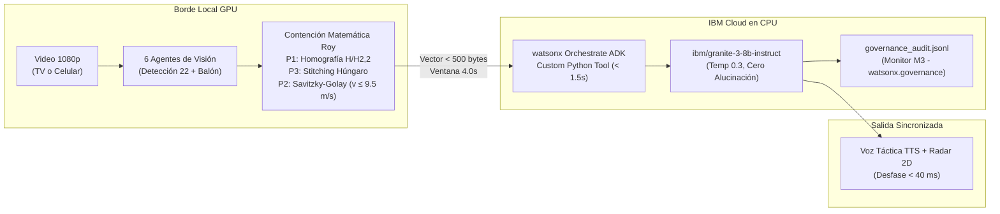

# 📖 OMNIMORPH v3 — Storytelling: La Crónica de los Dos Mundos

**Convocatoria:** IBM SkillsBuild AI Experiential Learning Lab México 2026  
**Proyecto:** Omnimorph (`omnimorph-ibm-ai-lab`)  
**Propósito:** Sustento narrativo, ético y humano para el jurado evaluador de IBM y la comunidad deportiva.

---

## 1. El Doble Abismo del Fútbol Moderno

El fútbol despierta pasiones porque es un juego colectivo de espacios y decisiones bajo presión. Sin embargo, detrás del espectáculo televisivo y las canchas de barrio, el deporte moderno padece una fractura silenciosa: **la distancia abismal entre el dato frío y el ser humano que patea el balón**.

Esta fractura tiene dos rostros opuestos que ocurren al mismo tiempo cada fin de semana.

```
                                  LA FRACTURA DEL FÚTBOL ACTUAL
                                                │
                 ┌──────────────────────────────┴──────────────────────────────┐
                 ▼                                                             ▼
         EL VESTIDOR DE ÉLITE                                          LA CANCHA DE TIERRA
   • 40,000 coordenadas por tiempo.                              • 1.5 millones de partidos semanales.
   • 15 minutos en el descanso para decidir.                     • 15 minutos de visoria para 200 jóvenes.
   • Saturación de tablas incomprensibles.                       • El 95% del talento queda invisible.
   • "Demasiados datos, cero tiempo".                            • "Cero datos, cero oportunidades".
```

---

### Rostro 1: El Analista Saturado en el Vestidor de Primera División

Minuto 45 de un partido definitorio de primera división. Suena el silbatazo final del primer tiempo. Los futbolistas bajan las escaleras hacia el vestidor exhaustos, con el pulso a 170 pulsaciones por minuto. El director técnico entra golpeando la pizarra, buscando respuestas urgentes:  
*—"¿Por qué nos están ganando la espalda? ¿Quién perdió la marca en el carril central? Tenemos diez minutos para cambiar el parado o perdemos el partido."*

En la esquina del vestidor está el analista táctico del club. Tiene enfrente dos monitores portátiles con 20 pestañas abiertas de hojas de cálculo, mapas de calor estáticos y más de cuarenta mil coordenadas cartesianas $(x, y)$ generadas por sistemas de telemetría de 50 mil dólares. 

El analista está solo, saturado de información cruda. Para extraer una conclusión útil tendría que filtrar columnas, graficar distancias a mano y redactar una nota mientras el reloj avanza segundo a segundo. Cuando por fin identifica que la última línea defensiva retrocedió doce metros respecto al bloque medio, el árbitro ya está tocando la puerta para regresar a la cancha.

**La paradoja de la élite:** La tecnología moderna es capaz de medir cada centímetro que corre un futbolista profesional, pero no tiene una herramienta que traduzca millones de números abstractos en explicaciones tácticas claras cuando rueda el balón.

---

### Rostro 2: El Joven Invisible en la Cancha de Tierra

A quince kilómetros de ese estadio, en una cancha llanera de tierra compacta y cal desgastada en la periferia de Nezahualcóyotl, Mateo, de dieciséis años, se ajusta las agujetas de unos tenis gastados. Juega con el número 5 en la espalda. 

Ese domingo es un día especial: un club profesional anunció una visoria masiva gratuita. En las gradas de cemento hay más de doscientos muchachos esperando turno bajo un sol de treinta grados. A cada grupo le dan exactamente quince minutos de juego en una cancha llena de baches.

Mateo juega de mediocentro de contención posicional. Su trabajo no es hacer fintas ni correr como loco detrás de la pelota. Su virtud es la lectura espacial: se coloca siempre a espaldas de la primera línea de presión rival, corta líneas de pase antes de que nazca el peligro, temporiza cuando su lateral sube al ataque y mantiene a su equipo compacto en dieciocho metros. En los quince minutos de prueba, Mateo toca el balón apenas seis veces. Su equipo empata 0 a 0.

Al terminar el partido, el visor oficial —un exfutbolista cansado que lleva cuatro horas viendo partidos sin sombra— anota en su libreta:  
*—"Número 5: poca participación con pelota, sin iniciativa ofensiva. Descartado."*

El visor selecciona al delantero corpulento que midió 1.83 metros y anotó un gol en un rebote casual. Mateo se sube al microbús de regreso a casa con la cabeza agachada, creyendo que no tiene condiciones para el fútbol profesional. 

Nadie registró que en esos quince minutos Mateo completó catorce coberturas que forzaron al rival a jugar hacia atrás, recorrió dos kilómetros y medio y alcanzó un sprint pico de 7.8 metros por segundo al replegar tras pérdida. Para el sistema de captación, Mateo simplemente no existió.

**La tragedia del barrio:** En México se juegan semanalmente más de 1.5 millones de partidos de fútbol amateur. Sin embargo, el 95% del talento joven se pierde porque las visorías masivas siguen dependiendo de la intuición de un solo ojo humano en un cuarto de hora. Las herramientas de medición de la élite —chalecos GPS de Catapult a 2,000 dólares anuales o licencias de Wyscout a 10,000 dólares— son un muro infranqueable para una academia de barrio o una familia trabajadora.

---

## 2. La Metáfora Central: "El Radar de FIFA en la Vida Real"

Cualquiera que haya jugado un videojuego de fútbol moderno —sea FIFA o Football Manager— conoce una sensación muy particular:

Cuando tienes el mando en las manos, tus ojos nunca se quedan encerrados en el jugador que lleva el balón. De manera casi automática, la vista baja a la esquina inferior de la pantalla para consultar el **radar 2D**: ese pequeño mapa cenital donde 22 puntos de colores se mueven en perfecta sincronía métrica.

Mirando el radar sabes exactamente si el lateral rival se descuidó en la banda, cuándo mandar un pase filtrado a la espalda de los centrales o cuándo replegar el bloque defensivo. Tienes la perspectiva del estratega; entiendes la geometría del campo.

Pero cuando apagas la consola y te sientas a ver un partido real en la televisión o desde la tribuna, esa claridad desaparece. La transmisión broadcast te encierra en un plano cerrado que sigue el balón y oculta al 80% de los futbolistas que están organizando el juego sin posesión directa. Y en la narración, dos comentaristas repiten lo que ya estás viendo con tus propios ojos: *"la toca Ramírez, pasa con López"*. Nadie te explica por qué colapsó la estructura táctica.

Nos hicimos una pregunta directa:  
**¿Por qué el fútbol real no puede entenderse con la claridad, la inteligencia y la perspectiva de un simulador deportivo?**

Eso es **Omnimorph**.

Tomamos cualquier toma monocular común —sea la señal de televisión de un clásico o un video grabado desde la tribuna con un teléfono celular básico— y la convertimos en un tablero táctico en tiempo real:
* El **radar 2D cenital** que proyecta a los 22 jugadores como piezas de ajedrez sobre una cancha métrica de 120×70 metros.
* La **telemetría cinemática de cada futbolista**: su velocidad instantánea, su distancia entre líneas y su compacidad de bloque.
* Y en lugar de comentarios obvios, **un analista impulsado por Granite 3 8B de IBM** que narra al oído los movimientos tácticos invisibles en español natural.

---

## 3. El Puente Tecnológico: Domando el Caos del Mundo Físico

Para conectar la emoción del juego con la inteligencia artificial no podíamos cometer el error habitual de pedirle a un modelo de lenguaje que "mirara" un video y adivinara lo que pasa. El video es ruidoso, la cámara vibra y los futbolistas se cruzan constantemente. Si los datos de entrada son basura, la IA generará alucinaciones tácticas.

Construimos un puente de tres etapas: **Física en el borde, Orquestación ligera en IBM Cloud y Razonamiento fundacional con Granite 3 8B**.



### Las Tres Anclas Físicas de Roy (Líder Técnico):

1. **Problema P1: La cámara que vibra.** Cuando una cámara de transmisión hace paneos o un celular en tripié sufre ráfagas de viento, las esquinas de la cancha se mueven de cuadro a cuadro. Normalizamos la escala proyectiva dividiendo la matriz por $H_{2,2}$ e implementamos un filtro de media móvil exponencial (EMA) adaptativo. La proyección métrica sobre el plano no tironea ni salta: fluye con naturalidad.
2. **Problema P3: El jugador que desaparece.** Cuando dos futbolistas disputan un balón o se cruzan en un tiro de esquina, los algoritmos tradicionales intercambian sus identidades. Modelamos la persistencia como un problema de asignación óptima resuelto con el **Algoritmo Húngaro** y extrapolación cinemática. Si un jugador sale por un costado del tumulto, el sistema recuerda quién era y mantiene su trayectoria.
3. **Problema P2: La velocidad imposible.** La derivada simple de coordenadas en video genera que un jugador que da dos pasos rápidos parezca correr a 50 km/h por puro temblor de píxel. Aplicamos derivadas de Savitzky-Golay con ventana de 5 cuadros y establecimos una **cota fisiológica estricta de 9.5 metros por segundo** (34.2 km/h). Nadie en Omnimorph corre más rápido que un atleta de alto rendimiento.

### La Conexión con IBM Cloud y Granite 3 8B:

Con los vectores limpios, no enviamos imágenes pesadas a la nube. Generamos un paquete JSON ultraligero de **menos de 500 bytes** cada 4.0 segundos que describe el estado geométrico del bloque:
* Compacidad entre líneas (metros).
* Altura de bloque respecto a la portería.
* Deltas de velocidad punta y zonas activas de presión.

En IBM Cloud, **watsonx Orchestrate ADK** toma ese paquete en CPU y orquesta la inferencia con **`ibm/granite-3-8b-instruct`** en menos de 1.5 segundos con temperatura 0.3. 

El modelo no adivina; razona sobre geometría sólida y produce análisis táctico en español con el vocabulario real del vestidor: *"El equipo mantiene un bloque medio con dieciocho metros de compacidad; tras la recuperación, el extremo derecho ataca el intervalo entre central y lateral con un desmarque de ruptura a ocho metros por segundo."*

Y mediante el **Monitor M3**, watsonx.governance audita cada frase en `governance_audit.jsonl`, verificando que cada afirmación corresponda a una métrica física real. Cero alucinación. Cero fantasía.

---

## 4. El Pasaporte Táctico Objetivo: Justicia para el Semillero

Cuando llevamos este motor al fútbol de barrio, el impacto trasciende el pizarrón táctico y se convierte en **justicia deportiva**.

Imaginemos de nuevo el caso de Mateo en la visoria masiva de Nezahualcóyotl, pero esta vez con Omnimorph operando sobre un teléfono celular montado en un tripié detrás de la portería:

Al silbatazo final, Mateo no se va con las manos vacías ni dependiendo del mal humor de un visor fatigado. Diez minutos después de terminar el partido, el entrenador y la familia de Mateo reciben en su teléfono el **Pasaporte Táctico Objetivo** emitido por Omnimorph:

```
┌────────────────────────────────────────────────────────────────────────┐
│  PASAPORTE TÁCTICO OBJETIVO — OMNIMORPH v3                            │
│  Certificado por IBM watsonx.governance                                │
├────────────────────────────────────────────────────────────────────────┤
│  Jugador: Mateo R. | Edad: 16 años | Posición: Mediocentro (5)         │
│  Partido: Torneo Intermunicipal Neza | Formato: 11 vs 11               │
├────────────────────────────────────────────────────────────────────────┤
│  MÉTRICAS CINEMÁTICAS Y ESPACIALES (VENTANAS DE 4.0 s)                 │
│  • Compacidad de Bloque Sostenida: 18.4 m  [Percentil 89 categoría]   │
│  • Coberturas Defensivas Efectivas: 14     [Percentil 92 categoría]   │
│  • Velocidad Pico en Repliegue: 7.8 m/s    (28.1 km/h)                 │
│  • Distancia Estimada por 90 min: 10.4 km                              │
├────────────────────────────────────────────────────────────────────────┤
│  DICTAMEN TÁCTICO EMITIDO POR GRANITE 3 8B:                            │
│  "Pivote posicional con destacada lectura del juego sin balón.         │
│   Garantizó el balance defensivo en transiciones ofensivas del rival   │
│   y cerró de forma reiterada el carril interior. Alto valor táctico    │
│   para esquemas de presión estructurada."                              │
├────────────────────────────────────────────────────────────────────────┤
│  Trazabilidad: Auditado en governance_audit.jsonl | Skew < 40 ms       │
└────────────────────────────────────────────────────────────────────────┘
```

Cuando un visor de un club profesional abre este reporte, ya no está viendo un video borroso con reggaeton de fondo enviado por WhatsApp. Está viendo **telemetría estandarizada, comparable y objetiva**. 

El contención invisible deja de ser invisible. El extremo desasistido (Kevin) demuestra que sus desmarques a 32 km/h son de élite aunque su mediocampo no haya conectado el pase. Y el club puede fichar talento con base en métricas reales, disminuyendo el riesgo de apostar únicamente por corazonadas o intermediarios.

---

## 5. El Veredicto Final: Tecnología con Sentido Humano

En México y Latinoamérica escuchamos cada cuatro años el mismo lamento: *"nos falta talento en la selección, no producimos jugadores de clase mundial"*.

Pero cualquiera que haya caminado por las canchas de tierra de Iztapalapa, los llanos de Veracruz, las ligas nocturnas de Monterrey o los campos de barrio en Colombia y Argentina sabe que esa afirmación es falsa. **El talento no falta; sobra en cada esquina.**

Lo que faltaba era un puente tecnológico accesible. Un sistema que no exigiera contratos millonarios con Catapult ni cámaras de fibra óptica en estadios de primera división.

Con Omnimorph unimos la solidez geométrica de la visión por computadora con la inteligencia gobernada de **IBM watsonx** para lograr algo indispensable: **nivelar la cancha**. Para que el analista de primera división pueda salvar un partido en el entretiempo, y para que el próximo gran futbolista de nuestro país nunca más sea descartado por falta de un dato que hable por él.
