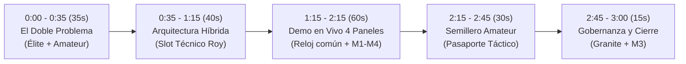

# Blueprint de Proyecto: OMNIMORPH v3 — Pitch, Storytelling & Submission Pack

**Workspace:** `/Users/home/agy2-projects/omnimorph-v3`  
**Repositorio GitHub:** `omnimorph-pitch-storytelling` (Público, vía `gh` CLI)  
**Proyecto Base de Referencia:** [Rogelio756/omnimorph-ibm-ai-lab](https://github.com/Rogelio756/omnimorph-ibm-ai-lab)  
**Marco de Trabajo:** IBM SkillsBuild AI Experiential Learning Lab | México 2026  
**Autor / Lead Architect:** `00 - Orchestrator`

---

## 1. Enfoque del Proyecto y Entregables Oficiales de Envío

Eliminamos el papeleo genérico y alineamos todo el repositorio a los **requisitos exactos de entrega de IBM SkillsBuild**:

| Eje | Decisión de Enfoque y Entrega Oficial |
| :--- | :--- |
| **Entregable Oficial 1** | **URL del Video de Demostración de 3 Minutos:** Acceso público. Guión milimétrico de 180 segundos que cubre: Problema (Élite + Amateur) $\rightarrow$ Arquitectura y Motor (Slot Roy) $\rightarrow$ Demo en vivo de 4 paneles $\rightarrow$ Democratización y Gobernanza. |
| **Entregable Oficial 2** | **Documento Escrito sobre el Problema y la Solución ($\le 500$ palabras):** Texto de alto impacto en `PROBLEMA_Y_SOLUCION.md`, estructurado con precisión para convencer a especialistas técnicos sin superar el límite estricto de palabras. |
| **Perfil del Jurado** | **Tres especialistas en el área con conocimientos y experiencia en los requisitos evaluables:** Dominan la rúbrica oficial, evaluarán watsonx Orchestrate ADK, watsonx.ai (`ibm/granite-3-8b-instruct`), watsonx.governance (Monitor M3), viabilidad técnica y propuesta de valor. Cero margen para palabrería vacía. |
| **Tono** | Rigor técnico comprobado, español natural y apasionado, vocabulario futbolero auténtico y cero clichés de IA. |
| **El "Por Qué"** | **1. En la élite:** El analista deportivo ahogado en números que necesita un "traductor táctico" en tiempo real.<br>**2. En la comunidad:** Democratizar el análisis para el fútbol amateur; convertir videos cotidianos de smartphone en un "pasaporte táctico objetivo" para chicos que hoy son invisibles para las visorías tradicionales. |

---

## 2. Mapa de Entregables en el Repositorio

```text
omnimorph-pitch-storytelling/
├── .gitignore                  # Excluye .DS_Store, caches y scratch
├── GEMINI.md                   # Reglas de estilo: tono natural, cero clichés de IA
├── README.md                   # Portada ejecutiva del proyecto, elevator pitch de 60s y enlaces a entregables
├── PROBLEMA_Y_SOLUCION.md      # ENTREGABLE OFICIAL: Síntesis ejecutiva de Problema y Solución (≤ 500 palabras)
├── PITCH_DECK.md               # Guión exacto para el VIDEO DE 3 MINUTOS (180s) diapositiva por diapositiva con tiempos
├── STORYTELLING.md             # Narrativa profunda: del dolor del analista de élite al semillero amateur
├── GUIA_DEMO_Y_QA.md          # Guía para grabar la demo de los 4 paneles y banco de respuestas a preguntas de especialistas
└── INVESTIGACION_Y_AMATEUR.md  # Benchmarks de evaluación para IBM y fundamentación del semillero amateur
```

---

## 3. Calibración del Pitch de 3 Minutos (180 Segundos)

El video oficial de 3 minutos debe ejecutarse con precisión de reloj:



* **0:00 - 0:35 (35 s) | El Problema:** En la élite, analistas saturados de datos que tardan horas en traducir; en el llano, 1.5 millones de partidos semanales donde el talento es invisible por falta de métricas.
* **0:35 - 1:15 (40 s) | La Solución y el Motor Técnico (Slot de Roy):** Arquitectura híbrida. GPU local (6 agentes de visión) + contención matemática ($P_1$ homografía EMA, $P_2$ Savitzky-Golay, $P_3$ stitching húngaro) + **watsonx Orchestrate ADK** en CPU ($< 1.5$ s).
* **1:15 - 2:15 (60 s) | Demostración en Vivo:** Los 4 paneles sincronizados por $(frame, t)$: Video con marcas $\rightarrow$ Radar cenital 2D $\rightarrow$ Métricas de ventana de 4 s $\rightarrow$ Narración de **`ibm/granite-3-8b-instruct`** con TTS en español. Semáforos en `PASS`.
* **2:15 - 2:45 (30 s) | Democratización del Talento:** Cómo el video de un smartphone se transforma en un "Pasaporte Táctico Objetivo", eliminando el sesgo de las visorías masivas de 15 minutos.
* **2:45 - 3:00 (15 s) | Gobernanza y Cierre:** Auditoría ética en `governance_audit.jsonl` (Monitor M3), cero alucinación, viabilidad económica. Cierre contundente.

---

## 4. Plan de Redacción para `02 - Pitch & Storytelling Writer`

`02` ahora redacta con estos dos entregables obligatorios como prioridad absoluta:
1. `PROBLEMA_Y_SOLUCION.md` ($\le 500$ palabras estrictas).
2. `PITCH_DECK.md` (calibrado a 3 minutos / 180 s con timestamps).
3. `STORYTELLING.md` (narrativa completa de los dos mundos).
4. `GUIA_DEMO_Y_QA.md` (guía de grabación del video de 3 min + preguntas de los 3 especialistas).
5. `README.md` (one-pager ejecutivo).
