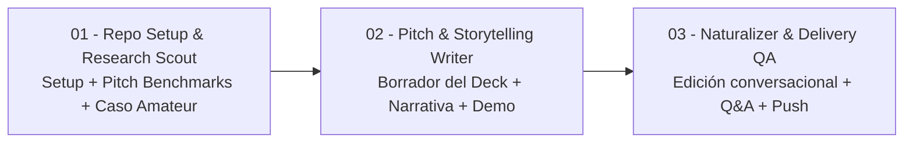

# Blueprint de Proyecto: OMNIMORPH v3 — Pitch, Storytelling & Presentation Pack

**Workspace:** `/Users/home/agy2-projects/omnimorph-v3`  
**Repositorio GitHub:** `omnimorph-pitch-storytelling` (Público, vía `gh` CLI)  
**Proyecto Base de Referencia:** [Rogelio756/omnimorph-ibm-ai-lab](https://github.com/Rogelio756/omnimorph-ibm-ai-lab)  
**Marco de Trabajo:** IBM SkillsBuild AI Experiential Learning Lab | México 2026  
**Autor / Lead Architect:** `00 - Orchestrator`

---

## 1. Enfoque del Proyecto: Cero Burocracia, Puro Impacto

Eliminamos el papeleo genérico de plantillas institucionales. Todo el esfuerzo se concentra en **convencer, emocionar y demostrar**:

| Eje | Decisión de Enfoque |
| :--- | :--- |
| **Objetivo central** | Un Pitch Deck memorable y una narrativa de Storytelling auténtica que conecte la tecnología real de Omnimorph con el dolor humano del deporte. |
| **Audiencia** | Comité evaluador y directivos de IBM (Maciel y jurado), manteniendo la historia accesible y emocionante para el público general. |
| **Tono** | 100% conversacional, técnico pero humano, sin ningún rastro de lenguaje acartonado o corporativo de IA. |
| **El "Por Qué"** | **1. En la élite:** El analista deportivo ahogado en números que necesita un "traductor táctico" en tiempo real.<br>**2. En la comunidad:** Democratizar el análisis para el fútbol amateur; convertir videos cotidianos en datos que sirvan de semillero de talento para chicos que hoy no tienen acceso a fuerzas básicas. |

---

## 2. Mapa de Entregables en el Repositorio

```text
omnimorph-pitch-storytelling/
├── .gitignore                  # Excluye .DS_Store, caches y scratch
├── GEMINI.md                   # Reglas de estilo: tono natural, cero clichés de IA
├── README.md                   # One-Pager ejecutivo del proyecto, propuesta de valor y pitch en 1 minuto
├── PITCH_DECK.md               # Diapositiva por diapositiva: mensaje clave, visual sugerido y guión palabra por palabra
├── STORYTELLING.md             # Narrativa de fondo: el traductor táctico y el semillero amateur
├── GUIA_DEMO_Y_QA.md          # Cómo guiar la demo de los 4 paneles y banco de respuestas a preguntas difíciles del jurado
└── INVESTIGACION_Y_AMATEUR.md  # Benchmarks de pitch de impacto + sustento del caso de fútbol amateur
```

---

## 3. Plan de Equipo Optimizado

Eliminamos el rol de "documentación de diseño" y adoptamos un flujo de 2 o 3 chats ágiles enfocado exclusivamente en investigación, redacción y pulido:



* **`01 - Repo Setup & Research Scout`**: Inicializa el repo en GitHub (`omnimorph-pitch-storytelling`), investiga qué buscan los evaluadores de IBM en un pitch ganador y documenta el caso real del fútbol amateur/comunitario.
* **`02 - Pitch & Storytelling Writer`**: Redacta el primer borrador robusto del Pitch Deck (diapositivas, tiempos, guión del presentador), la narrativa de storytelling y la guía de demostración de los 4 paneles.
* **`03 - Naturalizer & Delivery QA`**: Toma el borrador, lo reescribe para que suene 100% natural y personal (eliminando cualquier frase rígida), prepara la defensa de preguntas difíciles de IBM y hace el push final.

*(Nota: Si prefieres ir aún más rápido, `02` y `03` se pueden unificar en un solo chat maestro de redacción y entrega).*
